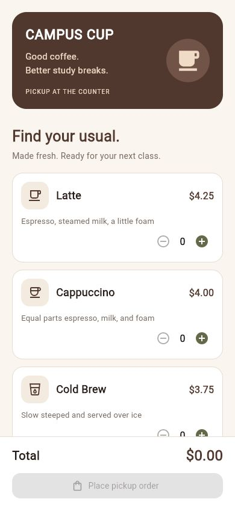
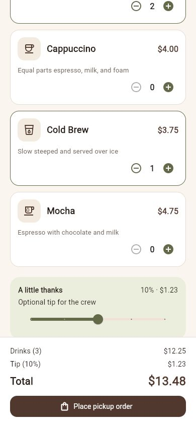
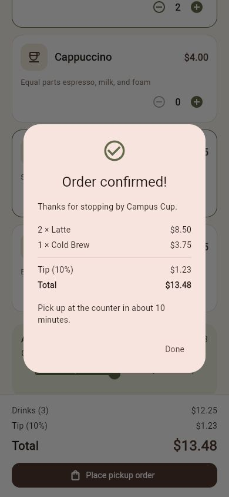

# Campus Cup

A Flutter app for ordering coffee for pickup. The menu includes a latte, cappuccino, cold brew, and mocha. Use the + and − buttons to change quantities, add an optional tip, and confirm the order.

## Run

Install Flutter and the Flutter extension in VS Code. Open this folder in VS Code, then run:

```sh
flutter pub get
flutter run -d chrome
```

The app also runs on Android with a connected device or emulator.

## Features

- Four drinks with names, descriptions, and prices
- A coffee cup logo and a consistent coffee shop theme
- Quantity controls, with up to nine of each drink
- A tip section that appears after a drink is selected
- A total that updates with quantities and the optional tip
- A confirmation dialog showing the order and pickup message
- Reusable header, drink card, and price row widgets

The additional widget explored is `Slider`, used to choose a tip from 0% to 20% in 5% steps. Prices are stored in cents, and tips round to the nearest cent. This is a class project; orders stay inside the app.

## Screenshots

  

## Check

```sh
flutter analyze
flutter test
```

The widget tests cover an empty order, quantity changes, tip rounding, confirmation and reset, and a small phone layout.
